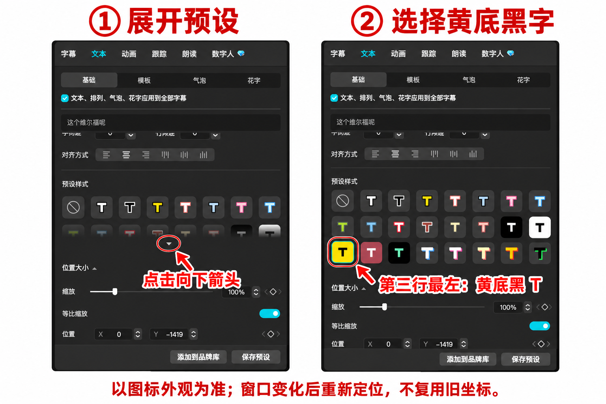

# 剪映自动字幕与导出

使用剪映专业版完成本地视频字幕制作，保留可编辑草稿。通过 Computer Use 的 `cua_repl` 操作应用；不通过脚本修改剪映草稿或用其他视频工具替代剪映。

## 输入与默认值

- 必需：源视频的本地绝对路径。沿用当前对话已经提供的文件，不要把示例文件当作本次输入。
- 样式：默认使用本流程的黄底黑字预设；用户指定其他样式时按其要求执行。
- 导出：用户要求完整复用本流程时包含导出；如果只要求制作字幕或明确暂不导出，则停在可编辑草稿。
- 导出目标默认是源视频所在目录，文件名为 `<源文件名去扩展名>_字幕版.mp4`。用户提供的路径或文件名优先。
- 示例：`/目录/a303.mp4` → `/目录/a303_字幕版.mp4`。

## 1. 连接剪映

遵循当前 Computer Use 工具返回的初始化说明，再执行 UI 操作。

1. 尝试通过应用显示名称获取剪映专业版。
2. 名称解析失败时，通过 `cua.listApps()` 获取真实应用标识。
3. 如果 bundle ID 对应多个辅助进程，改用已返回的主应用完整路径；本次环境验证过的路径是 `/Applications/VideoFusion-macOS.app`，bundle ID 是 `com.lemon.lvpro`。其他机器以实际发现结果为准。
4. 查看当前窗口，建立独立草稿；不要无意修改用户正在编辑的其他项目。

## 2. 导入并加入时间线

1. 在首页选择「开始创作」，在素材页选择「导入」。
2. 在系统文件选择器使用 `super+shift+g` 打开「前往文件夹」。
3. 输入源视频绝对路径。中文路径优先使用 `setValue` 或 `paste`；本次操作中 `typeText` 曾漏掉中文。提交前核对字段内容。
4. 在文件选择器确认选中的文件名与路径，再点击「导入」。
5. 将视频素材拖入主视频轨道，并验证轨道出现素材、总时长正确。素材库中出现缩略图不等于已加入时间线。
6. 拖放未生效时，可使用素材右键菜单「根据选中素材新建时间线」。这条备用路径在本次环境有效；切换后确认活动时间线确实包含视频。

## 3. 自动生成字幕

1. 打开顶部「字幕」→「智能识别」→「识别字幕」。
2. 源语言默认保留「自动检测语言」，除非用户指定语言。
3. 不额外启用翻译、智能划重点、智能去水词等选项。
4. 点击「开始识别」，观察识别进度并等待完成。识别正在进行时不要重复提交。
5. 完成后确认字幕轨道已经生成。新识别字幕默认是白色，直接进入第 4 节选择黄底黑字预设；不先播放、暂停或查找白色字幕来验证默认样式。等待识别完成后再操作样式，不在识别进度弹窗中点击。

## 4. 统一黄底黑字样式

按「识别完成 → 选中时间线字幕 → 全部字幕 → 预设样式 → 展开 → 第三排最左侧黄底黑字 → 预览校验」操作。先应用目标预设，再校验字幕显示。预设通常没有可检索名称，使用当前截图的外观定位最快。

### 4.1 打开正确的样式面板

1. 识别完成后直接单击时间线上的任一字幕片段，打开右侧文字编辑面板；若已自动进入正确面板，则直接继续。不要求此时播放头位于字幕内，也不要求预览先显示白色文字。
2. 确认右侧显示「字幕 / 文本 / 动画…」，进入「文本」→「基础」。若仍显示「画面、音频、变速」或仅显示「属性」，说明选中了视频或多个对象，重新单击时间线字幕片段；只有片段难以选中且预览已有文字时，才双击预览文字。
3. 确认「文本、排列、气泡、花字应用到全部字幕」为勾选状态（本次版本显示青色勾）。先确认此项，再点预设，避免只修改当前一句。

### 4.2 最快找到黄底黑字预设

定位时先查看 [预设样式标注截图](assets/preset-yellow-black-guide.png)：左图圈出折叠状态下的展开箭头，右图圈出展开后第三行最左侧的黄底黑 T。图片由实际剪映界面截图裁切合成并标注，仅作外观与相对位置参考；操作仍以当前截图为准，不从参考图照搬绝对坐标。

1. 在右侧属性面板内部向下滚动，直到看到「预设样式」和一组字母 T 小方块。本次版本从面板顶部向下滚动约两屏即可到达；以标题为准，看到后就停止滚动，不滚动整个编辑器或时间线。
2. 先看网格是否完整：折叠状态通常只显示第一行和一部分第二行，下方图标被渐隐遮住。点击网格底部中央的小向下箭头一次展开；不要点击「预设样式」标题，也不要反复点击箭头造成展开后又收起。
3. 展开后寻找 **整个方块是亮黄色实心底，中央是黑色 T** 的图标。本次剪映版本验证的位置是 **第三行第一个（最左侧）**。先检查这个位置，可省去逐个试点；版本或布局变化时仍以图标外观为准。
4. 区分容易误选的图标：第一行中的「黄色 T + 深灰底」会生成黄色文字，不是目标；目标必须是「黄色底 + 黑色 T」。不要凭黄色元素或字母颜色单独判断。
5. 若目标不在上述位置，先确认网格已展开且能看到第三行，再在当前可见网格中按外观查找；确需滚动时只在右侧面板继续滚动，并重新截图定位。不要通过切换字体、花字、气泡或字幕模板寻找这个预设。
6. 根据最新截图点击目标一次，随后读取 `getAXState()`。本次版本预设图标通常不暴露有意义的 AX 名称，坐标点击更直接；坐标必须从当前截图取得，不保存或复用某次操作的绝对坐标。

### 4.3 确认应用成功

1. 应用黄底黑字预设后，再将播放头放在一条字幕片段的中间。选中片段本身不代表播放头已位于片段内，随机跳转可能落在字幕间隙。查看目标图标是否出现选中边框（本次版本为青色），并检查有效字幕时间内的预览：应为 **黑色正文 + 黄色实心底框**。图标选中边框只是辅助证据，预览效果才是结果。
2. 若预览暂未刷新，短暂播放后暂停再检查；不要因为画面未立即变化就反复点预设。
3. 选择另一条相隔较远的字幕，将播放头移到片段中间，短暂播放并暂停，确认同样是黄底黑字。若只有第一句改变，回到「应用到全部字幕」核对勾选，再应用一次目标预设。
4. 应用预设即可，无需再修改字体。保留默认字体、字号、位置、缩放和不透明度，除非用户另有要求，或已在有效字幕时间内确认存在明显遮挡、裁切问题。

### 应用预设后，预览暂时没有字幕时

先检查播放头是否真正落在一条已生成字幕的起止时间内。放大时间线或选中字幕后，将播放头移至片段中间；若仍未显示，短暂播放并暂停，重新观察预览。确认处于字幕有效时间且画面刷新后，再检查轨道可见性。只有发现具体参数异常时才修改，不通过试改字体、字号、位置或透明度排查。

## 5. 导出字幕版 MP4

仅在任务包含导出时执行。

1. 打开右上角「导出」。核对导出的活动时间线和完整时长。
2. 在「标题」填写目标文件名主体；格式选择 MP4，由剪映添加 `.mp4` 后缀。
3. 设置「导出至」为目标目录。导出面板的 `ExportFileNameInput` 通常会在无障碍树中显示完整输出路径，利用它核对目录、中文名称与扩展名。
4. 默认保留原始分辨率和已有帧率；不额外启用一键超清、补分辨率、云备份或单独音频导出。
5. 确认输出路径不同于源文件；若已有同名输出且出现覆盖提示，不静默覆盖用户未明确授权替换的文件。
6. 点击「导出」，等待进度完成。只有界面明确显示「导出成功」才算完成，不能把开始导出或进度消失当成成功。
7. 到达导出成功页即停止；不要点击「发布」、分享链接或云端审阅。
8. 最终回复简短说明成功，并提供输出文件的绝对路径链接。若未导出，说明草稿状态及实际草稿名。

## 界面操作与验证要点

- 每轮操作后读取最新 `getAXState()`，按当前树重新识别元素。
- 本次版本部分 AX 按钮点击后没有动作。若状态无变化，查看截图并按当前画面的坐标点击，不把无异常返回当成成功。
- 截图、窗口大小或屏幕缩放变化后重新定位；不要复用历史截图的像素坐标。截图中可能出现较大空白区域，需结合操作后状态确认坐标映射。
- 工具偶发超时、pipe closed 或提示用户改变窗口时，先刷新状态确认动作是否已经生效，再决定是否重试，避免重复导入、识别或导出。
- 长任务约每分钟更新一次用户可理解的进展；不频繁重复轮询未变化的界面。
- 遇到需要登录、付费或其他无法继续的实际阻碍，报告具体界面及已完成步骤；不要声称已完成剩余操作。

## 完成标准

字幕制作完成：视频已在活动时间线中、自动字幕已生成、全部字幕应用样式已启用、预览能看到黄底黑字，另一处字幕验证一致。

导出完成：输出绝对路径与命名要求一致，剪映显示「导出成功」。保留原视频和可编辑草稿。
